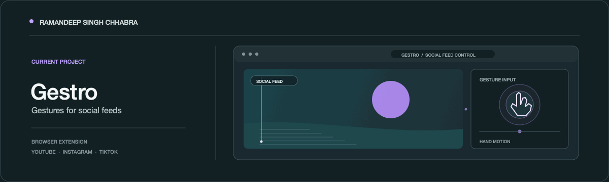

### About

Computer Science (Advanced AI) student at Medi-Caps University, India.

### Gestro

A browser extension for scrolling through YouTube, Instagram, and TikTok with hand gestures. Pause, skip, and move through short-form feeds without reaching for the mouse.

### Contributions

<picture>
  <source media="(prefers-color-scheme: dark)" srcset="https://raw.githubusercontent.com/ramandeepsinghchhabra/ramandeepsinghchhabra/output/github-contribution-grid-snake-dark.svg" />
  <source media="(prefers-color-scheme: light)" srcset="https://raw.githubusercontent.com/ramandeepsinghchhabra/ramandeepsinghchhabra/output/github-contribution-grid-snake.svg" />
  
</picture>

### Contact

[Email](mailto:ramandeepsinghchhabra13@gmail.com) · [GitHub](https://github.com/ramandeepsinghchhabra)
